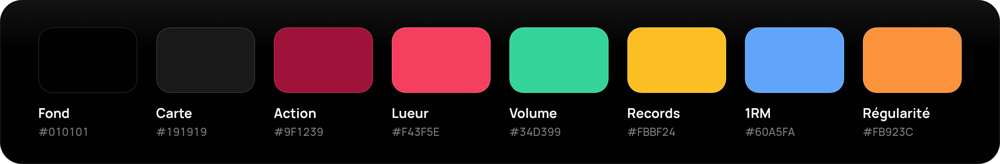

<p align="center">
  
</p>

<h1 align="center">Repster</h1>

<p align="center">Ton carnet de bord de musculation.</p>

<p align="center">
  <a href="https://repster-app.com"><b>Ouvrir l'app</b></a> ·
  <a href="#stack">Stack</a> ·
  <a href="#démarrer">Démarrer</a>
</p>

---

Repster est une application de suivi de musculation. Tu composes tes programmes, tu
lances ta séance, et l'app te guide série après série : charges, répétitions, tempo,
temps de repos. Tout ce que tu enregistres devient ensuite des courbes de progression.

Pas de fil social, pas de plan imposé, pas de publicité : un carnet d'entraînement,
rapide à utiliser entre deux séries.

L'app est disponible sur le web, Android et iOS depuis une seule base de code Flutter.

## Ce que fait l'app

| Fonction | En pratique |
|---|---|
| **Programmes** | Les séances se rangent dans des programmes (PPL, Full body…), dont un seul est actif à la fois. Chaque exercice porte ses séries, ses répétitions, son tempo `3-1-2-0` et son repos, et peut former un superset. |
| **Séance live** | Un écran par exercice : validation d'une série en un geste, réglette de charge, minuteur de repos avec signal sonore, rappel de la dernière performance. On peut remplacer ou ajouter un exercice en cours de route. |
| **Progression** | Tonnage, volume par semaine, et pour chaque exercice une courbe de 1RM estimé avec sa tendance. Les records ont leur panneau. |
| **Régularité** | L'accueil propose la prochaine séance et sa durée estimée, résume la semaine et affiche une grille des jours d'entraînement. |
| **Catalogue** | Une banque d'exercices certifiés, recherchable dans les cinq langues et sans tenir compte des accents. |
| **Langues** | Anglais, français, espagnol, allemand, italien. |

## Direction artistique

Repster est sombre par défaut, et repose sur trois règles.

- **Du noir et une seule couleur.** Un fond quasi noir, un rose profond pour l'action.
  Les autres couleurs sont réservées aux données.
- **Une seule surface colorée par page.** Sur l'accueil, c'est la carte de la prochaine
  séance. Le reste est en cartes translucides, éclairées par le haut.
- **Aucun résidu Material.** Pas d'effet d'encre ni de halo de défilement : un seul
  état pressé dans toute l'app.



La typographie est **Manrope**, embarquée dans l'app. Les icônes viennent de Lucide et
de Heroicons. Chaque séance a pour image un emoji Fluent 3D, qui lui donne aussi sa
teinte.

## Stack

| Domaine | Outils |
|---|---|
| **Application** | Flutter 3.38, Dart 3.10 |
| **État** | Riverpod |
| **Navigation** | go_router |
| **Backend** | Supabase : authentification, Postgres, stockage, Edge Functions |
| **Modèles** | freezed, json_serializable |
| **Traductions** | slang, avec des clés typées à la compilation |
| **Qualité** | very_good_analysis, flutter_test, mocktail |

## Architecture

Chaque fonctionnalité est un dossier découpé en quatre couches. Les dépendances ne
vont que dans un sens : l'interface ne parle jamais directement à la base.

| Couche | Rôle |
|---|---|
| `presentation/` | Écrans et widgets |
| `application/` | Logique d'écran, notifiers Riverpod |
| `data/` | Repositories : le seul endroit qui parle à Supabase |
| `domain/` | Modèles immuables, en Dart pur |

```
lib/
├── core/        thème, routeur, erreurs, Supabase
├── features/    auth, dashboard, templates, session, history, stats, profile…
├── shared/      widgets et animations communs
└── i18n/        traductions
supabase/
├── migrations/  schéma de la base
└── functions/   Edge Functions
```

Le détail des règles est dans [`AGENTS.md`](AGENTS.md).

## Démarrer

Il faut Flutter 3.38 ou plus récent, et un projet Supabase.

```bash
git clone https://github.com/deleusec/repster-app.git
cd repster-app

cp .env.example .env      # renseigner SUPABASE_URL et SUPABASE_ANON_KEY
flutter pub get
flutter run --dart-define-from-file=.env
```

> [!IMPORTANT]
> `--dart-define-from-file=.env` est obligatoire à chaque `flutter run` et
> `flutter build`. Sans lui, l'app s'arrête au démarrage.

Sur une base vierge, le schéma s'applique avec `supabase db push`.

## Qualité

```bash
flutter analyze    # analyse statique stricte
flutter test       # tests unitaires et de widgets
```

Les tests couvrent la séance live, le calcul des statistiques, la résolution des
exercices et les écrans principaux. Un harnais rend aussi les écrans en image, pour
relire un changement visuel sans lancer l'app :

```bash
flutter test test/design_preview_test.dart --dart-define=PREVIEW_OUT=/chemin/de/sortie
```

## Backend

Le schéma de la base est versionné dans [`supabase/migrations/`](supabase/migrations/).
La sécurité au niveau des lignes (RLS) est activée sur toutes les tables : chaque
utilisateur ne lit et n'écrit que ses propres données. Le compte se supprime depuis
l'app, et les données personnelles s'exportent sur demande.

## Déploiement

| Cible | Comment |
|---|---|
| **Web** | Compilé et hébergé par Vercel, installable en PWA |
| **Android** | `flutter build appbundle --release --dart-define-from-file=.env` |
| **iOS** | `flutter build ipa --release --dart-define-from-file=.env` |

---

Conçu et développé par **Aëvon**. © 2026, tous droits réservés.
